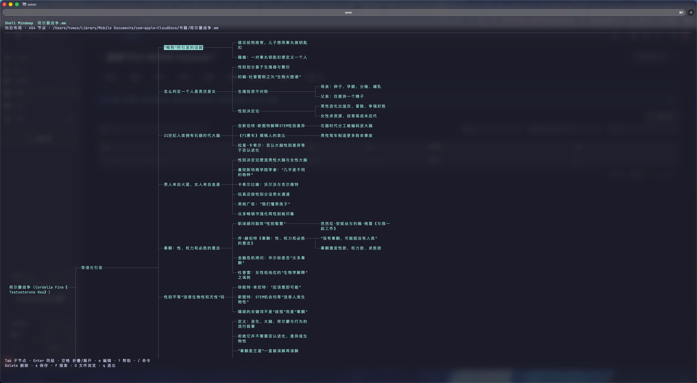

# Shell Mindmap

Draw and edit mind maps directly in your terminal. Navigate with the keyboard, build branches, and keep your maps in local plain-text files. Built with TypeScript, React, and Ink; no AI or cloud services are required at runtime.



## Features

- **Browse your files.** Start in the current directory, with a folder tree on the left and mind maps on the right. Expand folders as needed, filter entries, and switch to tabs in narrow terminals.
- **Edit with the keyboard.** Add, rename, fold, move, copy, and delete branches. Search every node, including hidden descendants, and undo or redo changes.
- **Use your own language.** Node text supports Unicode, including multilingual text and emoji. The current interface labels and messages are in Chinese.
- **Work with large outlines.** Node count, nesting depth, and text length have no fixed application limits. Practical capacity depends on memory and terminal performance.
- **Keep your work local.** Save compatible `.mm` files, import and export Markdown outlines, choose right-facing or two-sided layouts, and recover unsaved work from local snapshots.

## Installation

You need Git, **Node.js 22.9+**, **npm 11.10.0+**, and an interactive terminal with ANSI and UTF-8 support. Check your versions with `node --version` and `npm --version`; the npm version bundled with Node.js may need updating.

```sh
git clone https://github.com/verycafe/shell-mindmap.git
cd shell-mindmap
npm ci
npm run build
npm link
```

`npm link` makes the `SMM` command available globally by linking to this checkout. Keep the project directory in place and rebuild after updating the code. To run without a global link, use `node bin/SMM.js` from the project directory.

If PowerShell blocks script wrappers on Windows, use `npm.cmd` and `SMM.cmd`. The older `mm` command remains available as a compatibility alias.

## Getting started

Run `SMM` from any working directory:

```sh
SMM                               # Browse this directory; open or create a map
SMM "My map.mm"                    # Open a map, or start a new one at this path
SMM import outline.md -o outline.mm
SMM export outline.mm -o outline.md
```

With no file argument, `SMM` always opens the directory browser. Press `Tab` to switch between folders and maps, use the arrow keys to select an entry, and press `Enter` to open it. `Backspace` goes to the parent directory; `n` creates a map in the directory you are browsing.

Type a root topic and press `Enter` to confirm it. Press `Tab` to add a child; on a non-root node, press `Enter` to add a sibling. Press `s` to save. A new map is written to disk when you save it.

### Keyboard shortcuts

These defaults apply while navigating a mind map:

| Key | Action |
| --- | --- |
| Arrow keys | Navigate nodes; left selects the parent, right unfolds and selects a child |
| `Tab` / `Enter` | Add a child / sibling |
| `e` | Edit the selected node |
| `Space` | Fold or unfold the selected branch |
| `Delete` / `Backspace` / `d` | Delete the selected branch and its descendants |
| `f` / `Ctrl+F` | Search all nodes |
| `c` / `p` | Copy a branch / paste it as a child |
| `m` | Move a branch to another parent |
| `[` / `]` | Move a branch up / down among its siblings |
| `s` / `S` | Save / save as |
| `u` / `r` | Undo / redo |
| `Shift` + arrow keys | Pan the view; `H` / `J` / `K` / `L` also pan left / down / up / right |
| `g` / `Home` | Select the root and recenter the view |
| `O` / `q` | Open the file browser / quit |
| `/` | Open the command menu |
| `?` / `F1` | Open help |

On Mac keyboards, both the Delete key (backspace) and `Fn+Delete` can delete a branch. The root cannot be deleted. Press `u` to undo a deletion. While editing text, Space inserts a space and the deletion keys only remove characters.

The command menu supports fuzzy filtering by English command names or Chinese descriptions. Use the arrow keys to choose a command, `Tab` to complete it, and `Enter` to run it. Commands such as `/fold` and `/delete` display their current keyboard shortcuts. `SMM keys` lists available bindings; custom bindings take priority over convenience aliases.

## Files and Markdown

Maps use the existing `.mm` plain-text format. New maps normally save in the working directory; maps created from the file browser use the directory you chose there. Saving an existing map writes back to its original path. You can set a default save directory with `SMM config set save-dir PATH`.

Configuration and recovery snapshots are shared across workspaces and stored under `~/Shell Mindmap/.app`. This is the application's data directory, not the default location for your maps. Changing the save directory does not move existing files.

Markdown import accepts headings (`#` through `######`) and nested single-line unordered lists, recognizing relative indentation with spaces or tabs. Multiple top-level headings or lists without a root heading get a generated root node, preserving the original nodes and their order. Unsupported Markdown content produces an error instead of being silently dropped. Command-line import and export do not overwrite existing output files.

The default layout grows to the right. For a two-sided layout, run:

```sh
SMM config set layout bilateral
```

Font size is controlled by your terminal.

## Development

```sh
npm run check
npm test
npm run test:pty
```

PTY tests require macOS or Linux and Python 3. CI is configured for macOS, Linux, and Windows; terminal workflow tests run on macOS and Linux.

Install dependencies with `npm ci` to use the committed lockfile. The repository's `.npmrc` requires newly resolved dependency versions to have been published for at least seven days.
